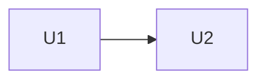

# Units of Work — [FEATURE_NAME]

**Nguồn**: plan.md, data-model.md, contracts/, stories.md (nếu có), nfr.md (nếu có).

Unit = một lát cắt có thể build + test + review độc lập, thường gắn với một (hoặc một nhóm nhỏ)
module và một tập user story. Unit đầu tiên SHOULD là "walking skeleton" tích hợp end-to-end.

## Danh sách unit

| Unit | Tên | Mục tiêu (giá trị giao được) | Module / thư mục | User stories | NFR | Owner | Ước lượng |
|------|-----|------------------------------|------------------|--------------|-----|-------|-----------|
| U1 | | | | | | | |

## Dependency DAG

| Unit | Phụ thuộc | Lý do |
|------|-----------|-------|

## Thứ tự giao (bolts)

| Bolt | Units (chạy song song được) | Điều kiện vào | Điều kiện xong (Definition of Done) |
|------|------------------------------|---------------|-------------------------------------|
| B1 | U1 | | build + test xanh, review đạt |

## Tiêu chí hoàn thành mỗi unit

- Đáp ứng mọi cổng chất lượng trong constitution (test, ranh giới, bảo mật…)
- Review độc lập đạt (`verify`)
