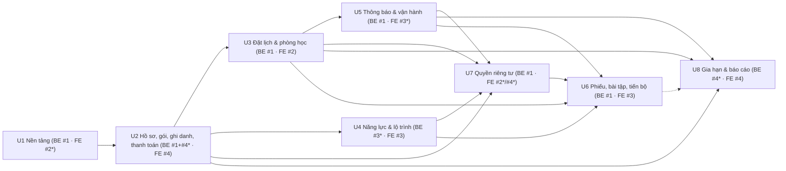

# Units of Work — Nền tảng đào tạo tiếng Anh 1 kèm 1 cá nhân hóa (001-personalized-english-tutoring)

**Nguồn**: plan.md (cập nhật 2026-10-18), spec.md (Clarifications 2026-10-12 và 2026-10-18), data-model.md,
contracts/rest-api.md, contracts/events-and-ports.md, research.md (R1–R17), aidlc/stories.md (52 story),
aidlc/nfr.md (53 NFR), `.specify/memory/constitution.md` v1.0.1 (ưu tiên cao nhất); quyết định của
leader (#1) ngày 2026-10-18 (phân công mới, ngày bắt đầu, 3 quyết định đã chốt — xem mục Quyết định).
**Stage**: AI-DLC 2.7 + 2.9 (Units Generation + Delivery Planning) · **Ngày**: 2026-10-18 · **Bản**: 2
(re-plan theo phân công mới) · **Trạng thái**: Draft, chờ duyệt

> **⚠ Lưu ý trước khi map task**: `tasks.md` hiện có là **bản cũ** (viết trước Clarifications
> 2026-10-18, trước bản plan cập nhật và trước phân công mới): thiếu FR-030/FR-031, `CANCELLED_SYSTEM`,
> chốt kết quả/chốt thay, quyết định Gián đoạn, chặn đổi lịch muộn, sao lưu R17, k6, gitleaks, rate
> limit; phân công theo module full-stack và lịch tuần 1 = 12–18/10 (tasks.md:356-363) không còn
> đúng. **MUST chạy lại `/speckit-tasks`** theo plan/spec hiện hành và phân công trong file này **trước
> khi** chạy `/speckit-aidlc-map-tasks`. Phân công trong plan.md:141-153 ("Phân công module") cũng đã
> lỗi thời so với quyết định mới — cần owner plan cập nhật.

Quy ước:

- Unit = lát cắt build + test + review độc lập, gắn với ranh giới module Spring Modulith
  (const:18-26; plan.md:88-139). U1 là walking skeleton.
- **Phân công (quyết định 2026-10-18)**: **#1** làm **toàn bộ backend** (`shared`, `identity`,
  `catalog`, `scheduling`, `learning`, `billing`, `notification`) + hạ tầng (CI, docker-compose,
  deploy, sao lưu). **#2** FE `features/scheduling`, `features/classroom` · **#3** FE
  `features/learning` · **#4** FE `features/catalog`, `features/billing`, `features/admin` (dashboard,
  báo cáo, quản lý người dùng). App shell / auth / consent gate / màn privacy / chuông thông báo
  **chưa có owner** — đề xuất ở OQ-1.
- **Đường găng là backend một người**: backend các unit làm **tuần tự**; frontend chạy trước trên
  mock (MSW) dựng từ hợp đồng API, rồi nối API thật khi backend của unit merge.
- Mọi phụ thuộc trong DAG là **phụ thuộc cứng** (unit trước Done trước). Vì backend tuần tự nên không
  còn cần cơ chế "stub cùng bolt" của bản 1.
- Ước lượng: ngày-người, **thô (±30%)**, tách BE / FE. S ≤ 2 · M 3–5 · L 6–8 · XL ≥ 9.
- **Giả định lịch**: tính theo **ngày lịch** (mọi ngày kể cả T7, CN đều là ngày làm việc), 1 ngày lịch
  = 1 ngày-người, vì chưa biết team có làm cuối tuần không (OQ-2). Bắt đầu **CN 2026-10-18**, ngày
  làm việc cuối **T4 2026-11-11**, demo **T5 2026-11-12** → **25 ngày** khả dụng.
- Repo hiện là greenfield (chưa có `backend/`, `frontend/`; `aidlc-state.md`: Workspace greenfield).
  Đường dẫn code là **dự kiến** theo plan.md:88-135.

---

## Danh sách unit

Số ngày BE là **sau** các cắt giảm đề xuất K1–K3 (bản trước cắt trong ngoặc). Phương án khuyến nghị
**S2** (xem mục Năng lực #1) chuyển phần BE nhỏ, độc lập của U2/U4/U8 cho #4/#3 — cột "BE owner" ghi cả
hai trường hợp.

| Unit | Tên | Mục tiêu (giá trị giao được) | Module / thư mục | User stories (chính) | NFR | BE owner / ngày | FE owner / ngày | Bolt (S2) | Ngày (S2) |
|------|-----|------------------------------|------------------|----------------------|-----|-----------------|-----------------|-----------|-----------|
| U1 | Nền tảng & walking skeleton | Repo + CI + docker-compose; giáo vụ đăng nhập, mời người dùng → email Mailpit → đặt mật khẩu → đăng nhập vào layout theo vai trò; bản skeleton chạy trên môi trường demo; hợp đồng mọi module | `shared`, `identity` (auth, user cơ bản), `notification` tối thiểu, khung 7 module, V1, `Dockerfile` + compose prod + Caddy · `frontend/src/app`, `lib/api`, `features/auth` | S-US1.1, S-US1.2, S-US1.3 (AC1–3), S-US1.10 (khung) | SEC-01, SEC-03, SEC-04, SEC-05, SEC-07, SEC-10, MAINT-01..04, MAINT-06, PORT-01, PORT-02, REL-04, REL-07, REL-08, UX-01, UX-02, OBS-01, PRIV-01, PRIV-02, COST-03, PERF-07 | #1 / 5,75 (6) | **đề xuất #2** / 4 | B1 | 18–23/10 |
| U2 | Hồ sơ, gói học, ghi danh & thanh toán | Quản lý hồ sơ HV/GV, khóa/gói, ghi danh + phân công/đổi GV; thanh toán đầu tiên kích hoạt gói; bộ đếm buổi chính xác qua `EnrollmentApi`; HV xem gói/thanh toán/công nợ chỉ đọc | `catalog`, `billing` (receivable, payment) · `features/catalog`, `features/billing`, quản lý người dùng trong `features/admin` | S-US1.4, S-US1.5, S-US1.6, S-US1.7, S-US1.8, S-US1.9 (HV/GV), S-US5.1, S-US5.2, S-US5.3 (bộ đếm), S-US5.4 | REL-02, REL-03, REL-08, SEC-01, SEC-02, PRIV-01, PRIV-04, PERF-01, UX-01 | #1 / 4 · S2: #1 3 + #4 1 (billing core) | #4 / 5 | B2 | 24–26/10 |
| U3 | Lịch rảnh, đặt lịch, trạng thái buổi & phòng học | Lịch rảnh/ngày nghỉ; đặt–hủy–đổi theo hạn chót; 0 trùng lịch; chốt kết quả, chốt thay, Gián đoạn; hủy hệ thống; job nhắc lịch/quá hạn chốt; vào phòng LiveKit đúng 2 người, đúng khung giờ | `scheduling` · `features/scheduling`, `features/classroom` | S-US2.1 … S-US2.12, S-US1.9 (buổi), S-US1.8 AC3, S-US1.4 AC3, S-US5.3 (chuyển trạng thái) | PERF-02, PERF-03, PERF-05, PERF-07, REL-01, REL-02, REL-05, REL-07, REL-08, SEC-01, SEC-02, SEC-08, SCAL-01, SCAL-02, UX-02, UX-03, PRIV-04 | #1 / 5,5 (6) | #2 / 6 | B3 | 27/10–01/11 |
| U4 | Hồ sơ năng lực, mục tiêu & lộ trình | GV ghi kiểm tra đầu vào/định kỳ (CEFR), mục tiêu **tùy chọn** có lịch sử (HV chưa có mục tiêu → cờ "Cần tư vấn"), tự soạn/điều chỉnh lộ trình kèm lý do; HV xem chỉ đọc | `learning` (assessment, goal, path, revision) · `features/learning` | S-US3.1 … S-US3.6, S-US1.4 AC1 (phần mục tiêu) | PORT-03, PRIV-04, SEC-01, SEC-02, REL-08, PERF-01, UX-01 | #1 / 1,5 · S2: #3 1,5 | #3 / 3 | B3 | 27–28/10 (S2, song song U3) |
| U5 | Thông báo, nhắc & vận hành demo | Mọi event → email + thông báo trong hệ thống, không trùng, thử lại có backoff; chuông thông báo; HTTPS, healthcheck, log rotation, sao lưu hằng ngày | `notification` · `features/notifications` · `deploy/` (backup sidecar) | S-US2.8, S-US2.9 (gửi), S-US4.2 AC1 (gửi), S-US5.5 (gửi) | PERF-05, REL-04, REL-05, REL-06, REL-07, REL-09, REL-10, SEC-05, SEC-07, PORT-01, SCAL-03, OBS-01, COST-01, COST-02, UX-01 | #1 / 2,75 (4) | **đề xuất #3** / 1 | B4 | 02–04/11 |
| U6 | Phiếu đánh giá, bài tập, tiến bộ & đánh giá sao | Buổi COMPLETED có phiếu PENDING; GV nộp phiếu < 3 phút; nhắc phiếu quá hạn; HV nộp bài, GV chấm 0–10; trang tiến bộ; HV chấm sao 1 lần trong 7 ngày | `learning` (report, assignment, progress, feedback, job) · `features/learning` | S-US4.1 … S-US4.6, S-US6.1, S-US1.10 AC5 | PERF-04, PERF-06, PERF-07, REL-05, REL-07, REL-11, SEC-01, SEC-02, SEC-09 (nếu giữ tệp), PORT-03, PRIV-02, UX-01 | #1 / 2,5 (4) | #3 / 3,5 (4,5) | B6 | 08–10/11 |
| U7 | Quyền riêng tư & bảo mật tài khoản (FR-030, FR-031) | Đồng ý chính sách (lần đầu + phiên bản mới, `CONSENT_REQUIRED`); HV < 16 tuổi chờ đồng ý người giám hộ; nhật ký yêu cầu chủ thể dữ liệu; ẩn danh hóa giữ nguyên số liệu (SC-007); trang tóm tắt in được | `identity/internal/privacy` · consent gate trong `features/auth`, `features/admin/privacy` | S-US1.11 … S-US1.15, S-US1.3 AC4, S-US1.4 AC5 | PRIV-01..04, SEC-01, SEC-02, SEC-04, REL-04, REL-05 | #1 / 3 (3,5) | **đề xuất** #2 (consent gate, 1) + #4 (màn privacy admin, 2) / 3 | B5 | 05–07/11 |
| U8 | Gia hạn, công nợ & báo cáo giáo vụ | Job hằng ngày: Hết hạn + nhắc gia hạn mỗi lý do 1 lần; gia hạn thủ công; danh sách công nợ; báo cáo doanh thu + số buổi đã dạy theo GV; dashboard | `catalog` (job, extend), `billing` (receivables, revenue) · `features/admin`, `features/billing` | S-US5.5, S-US5.6, S-US5.7 (+ S-US6.2, S-US6.3 nếu không duyệt K1) | PERF-01, PERF-06, REL-03, REL-07, PRIV-04, SEC-01, UX-01 | #1 / 1,5 · S2: #4 1,5 | #4 / 1,5 (3) | B5 | 05–06/11 (S2, song song U7) |

**Tổng BE**: 30,5 ngày-người trước cắt → **26,5** sau K1–K3 (S2: #1 làm 22,5; #3 làm 1,5; #4 làm 2,5).
**Tổng FE**: 29,5 trước cắt → **27** sau cắt (#2 ≈ 11 · #3 ≈ 7,5 · #4 ≈ 8,5, chưa gồm việc B7).

Không có unit nào chứa story [GĐ2] (xem Kiểm tra hợp lệ).

---

## Năng lực của #1 (backend) và phương án

**Khả dụng**: 25 ngày lịch (18/10 → 11/11). Nếu chỉ làm T2–T6: **18 ngày** (19–23/10, 26–30/10,
2–6/11, 9–11/11).

**Nhu cầu của #1** (ngày-người):

| Hạng mục | S0 (không đổi) | S1 (cắt K1–K3 + P1, P2) | S2 (S1 + D1) — **khuyến nghị** |
|----------|---------------:|------------------------:|-------------------------------:|
| Build BE U1–U8 | 30,5 | 26,5 | 22,5 (U4 → #3; U8 + billing core U2 → #4) |
| Review PR + điều phối (leader; const:95-99) | 3,5 | 2 (P1) | 2 |
| Ổn định B7 phía BE (sửa lỗi, diễn tập khôi phục, chạy k6) | 3 | 2 (P2) | 2 |
| **Tổng** | **37** | **30,5** | **26,5** |
| So với 25 ngày lịch | **−12** | **−5,5** | **−1,5** |
| So với 18 ngày T2–T6 | −19 | −12,5 | −8,5 |

**Kết luận**: S0 và S1 không khả thi. S2 thiếu ≈ 1,5 ngày — nằm trong sai số ước lượng nhưng **không
còn đệm**: overhead review chỉ còn 1,5 ngày và ổn định B7 chỉ còn 1 ngày (11/11). Nếu team **không làm
cuối tuần**, cả S2 cũng không khả thi; khi đó cần quyết định lớn hơn (thêm người làm BE hoặc lùi demo)
— ngoài thẩm quyền của file này.

### Cắt giảm đề xuất (chỉ từ mục "Rút gọn" của spec hoặc NFR hoãn được — **không** đụng FR-030/FR-031)

| # | Cắt | Nguồn cho phép | Story/NFR bị ảnh hưởng | Tiết kiệm BE | Tiết kiệm FE |
|---|-----|----------------|------------------------|-------------:|-------------:|
| K1 | Bỏ báo cáo chất lượng giảng dạy khỏi demo (FR-023): không làm `/reports/teacher-quality`, không tính tỷ lệ hủy/vắng; **giữ** `sessionsTaught` cho FR-027 và giữ đánh giá sao FR-022 (giáo vụ xem từng buổi qua `GET /sessions/{id}/feedback`) | FR-023 thuộc "Rút gọn" (spec.md:27); plan.md:160 "các mục rút gọn có thể cắt thêm"; thứ tự cắt tasks.md:370 | S-US6.2, S-US6.3 → ra khỏi demo | 1,0 (U3 0,5 + U6 0,5) | 1,5 (U8) |
| K2 | Nộp bài tập **chỉ dạng văn bản** (FR-020): không upload tệp/âm thanh, không pre-signed URL, không adapter `s3` cho `FileStorage` (sao lưu R2 dùng công cụ riêng trong sidecar) | FR-020 thuộc "Rút gọn" (spec.md:27) | S-US4.4 AC1 (phần tệp), AC2; NFR-SEC-09; quickstart bước 10 (mp3) | 1,5 (U5 0,5 + U6 1,0) | 1,0 (U6) |
| K3 | Hoãn NFR mức **Should**: NFR-SEC-06 (rate limit), NFR-OBS-02 (log JSON + `traceId`; vẫn giữ log rotation), NFR-OBS-03 (runbook SQL), NFR-MAINT-05 (CI so `schema.d.ts`) | nfr.md:69, :124, :125, :100 — ưu tiên Should | Không có story | 1,5 (U7 0,5 · U5 0,75 · U1 0,25) | — |

Tổng K1–K3: **4,0** ngày BE, **2,5** ngày FE.

### Biện pháp quy trình (không cắt phạm vi)

| # | Biện pháp | Tiết kiệm cho #1 |
|---|-----------|-----------------:|
| P1 | PR frontend do FE review chéo (constitution chỉ yêu cầu ≥ 1 review của thành viên khác — const:97); #1 chỉ review PR FE đụng `lib/api`, auth/consent hoặc security | 1,5 |
| P2 | Kịch bản k6 (`perf/`), Playwright smoke, test usability (NFR-PERF-03/04) và Lighthouse do FE viết/chạy (#2: k6 + Playwright luồng đặt lịch/phòng học; #3: usability phiếu; #4: smoke luồng giáo vụ) | 1,0 |
| D1 | **Cần leader quyết định (trái với chỉ đạo "FE chỉ làm frontend")**: chuyển 3 phần BE nhỏ, ít rủi ro, nằm gọn trong một module cho FE dev đang dư thời gian (FE mỗi người ≈ 7,5–11 / 25 ngày): **#3** làm BE U4 (CRUD learning I, 1,5); **#4** làm BE billing core của U2 (receivable/payment/kích hoạt, 1,0) và BE U8 (job gia hạn, extend, báo cáo, 1,5). #1 review từng PR (thay đổi module do #1 sở hữu → #1 review, const:99) | 4,0 |
| D4 | Hợp đồng API cho mock FE: FE dev tự viết handler MSW + type tạm từ `contracts/rest-api.md`; chuyển sang type sinh từ springdoc (`npm run gen:api`) khi BE của unit merge — để #1 không phải dựng trước controller stub cho mọi endpoint trong U1 | (đã tính trong ước lượng U1) |

### Quyết định của leader — ĐÃ CHỐT 2026-10-18

Leader duyệt cổng units: **K1, K2, K3, P1, P2, D1, D4 đều được duyệt** (phương án S2); owner FE theo đề xuất OQ-1
(#2: app shell/auth/consent gate · #4: màn privacy admin · #3: chuông thông báo). **Làm cuối tuần (OQ-2): CÓ — leader xác nhận
2026-10-18.** Spec/stories/quickstart đã cập nhật theo K1, K2.

Danh sách gốc (để tham chiếu):

1. Duyệt K1, K2, K3 (từng mục). Nếu **không** duyệt K1: U8 phụ thuộc U6 (`teacher-quality`) → U8 phải
   chuyển sang sau U6 (B6 → B7), B7 còn < 1 ngày. Nếu **không** duyệt K2: +1,5 BE, thêm lại spike
   pre-signed `Content-Length` (nfr.md Q9).
2. Duyệt P1, P2.
3. Duyệt D1 (ngoại lệ có giới hạn cho chỉ đạo "FE chỉ làm frontend"); nếu không, lịch S1 kết thúc
   ≈ 15–16/11 (sau demo) và phải cắt thêm phạm vi "Đầy đủ" (cần sửa spec).
4. Duyệt D4.
5. Xác nhận làm cuối tuần (OQ-2).

---

## Chi tiết từng unit

### U1 — Nền tảng & walking skeleton (B1 · 18–23/10 · BE #1 5,75 · FE đề xuất #2 4)

**BE (#1)**
- Monorepo `backend/` (Maven, Boot 4.1.x, Spring theo BOM; Enforcer `requireJavaVersion 21`, cấm `h2`)
  — const:80-85, NFR-MAINT-06; kiểm tra tương thích Boot 4.1 của thư viện bên thứ ba ngày đầu
  (plan.md:67).
- `docker-compose.yml` dev (postgres + `btree_gist`, mailpit, minio, livekit dev — plan.md:131);
  `.github/workflows/ci.yml` (`./mvnw verify` + frontend lint/test/build + gitleaks).
- `shared`: `SecurityConfig` deny-by-default, JWT HS256, CORS; validator JWT secret ≥ 256 bit;
  `GlobalExceptionHandler` Problem Details + `code` (rest-api.md:127-149); `Clock` UTC; paging; port
  `FileStorage` + `fake`; Actuator health.
- `V1__shared_infra.sql` (`event_publication`, `shedlock`); Event Publication Registry +
  `republish-outstanding-events-on-restart=true` (research.md:90); ShedLock `PT5M`.
- `identity`: `user_account` (đã có `date_of_birth`, enum status đầy đủ — data-model.md:30; hành vi
  < 16 tuổi ở U7), `auth_token`; `login`, `refresh`, `logout`, `accept-invite`, `forgot/reset-password`,
  `GET/PATCH /me`, `GET/POST /users`, `PATCH /users/{id}/status` (SPI `UserDeactivationGuard`, phát
  `UserDeactivated`), `resend-invite` (rest-api.md:15-36); BCrypt; `UserDirectory`.
- `notification` tối thiểu: port `EmailSender` + `smtp`/`fake`; `notification_dispatch` + `dedupe_key`;
  listener `UserInvited`, `PasswordResetRequested`.
- Hợp đồng module: event record của mọi module (events-and-ports.md:11-31), interface `EnrollmentApi`,
  `SessionQueryApi`, `VideoRoomProvider` (+ fake) — chỉ interface/record, bản thật ở unit tương ứng.
- Test support: Testcontainers `postgres:16`, `TestClockConfig`, builder; `ModularityTests`; khung
  test reflection `@PreAuthorize` (`AuthorizationRulesTest`) + ma trận tối thiểu cho endpoint identity
  trong `AuthFlowIT`; `AuthorizationMatrixIT` đầy đủ ở T140 (B7). ArchUnit **bỏ khỏi U1** (sửa sau verify
  U1, 2026-10-18): không có task trong tasks.md, ranh giới module đã do `ModularityTests` kiểm.
- `backend/Dockerfile` multi-arch, `deploy/docker-compose.prod.yml` (backend `mem_limit: 1g`, postgres,
  caddy), `Caddyfile` (TLS, 301, HSTS), `.env.example` — chỉ chuẩn bị file. **Deploy thật lên server
  chuyển sang U5** (tách khỏi U1 ngày 2026-10-18: Oracle từ chối đăng ký, đang chờ support).
- Profile `demo-seed` bản đầu.

**FE (đề xuất #2)**: Vite + React 19 + TS + Tailwind + shadcn/ui; router, layout theo vai trò, auth
guard, query client; fetch client có refresh token; khung MSW (D4) + `npm run gen:api`;
`useApiErrorToast` (mã lỗi → tiếng Việt); `DateTimeText`; route lazy; trang login, accept-invite,
forgot/reset; deploy Cloudflare Pages. #3, #4 song song dựng component trên mock.

**Spike FE (không phải unit)**: #2 thử `@livekit/components-react` với `livekit-server --dev` + token
tạo bằng CLI trong B1 (thay spike BE của plan.md:159).

**FR**: FR-001, FR-002, FR-004 (endpoint trạng thái), FR-013 (email mời/reset), FR-029 (khung port).
**Phát hành**: `UserDirectory`, `UserDeactivationGuard` (SPI), event `UserInvited`,
`PasswordResetRequested`, `UserDeactivated`, mọi event record/interface; app shell. **Tiêu thụ**: —.

**DoD riêng**: CI xanh (gồm `ModularityTests`, IT Testcontainers, gitleaks, Enforcer chặn `h2`);
`AuthFlowIT` với `TestClock` (access hết hạn, dùng lại refresh cũ → 401, `INACTIVE` → 401 —
NFR-SEC-04); forgot-password luôn 202 (NFR-SEC-10); hash BCrypt cost 10 (NFR-SEC-03); ma trận vai trò
cho endpoint identity (bản tối thiểu); app không khởi động khi secret < 32 byte; token mời/reset
không còn bản thô trong `event_publication`/`notification_dispatch` sau khi xử lý (NFR-SEC-03); retry
email + chống trùng có test (NFR-REL-06); T032 (2 trình duyệt vào cùng room, LiveKit local) do #1
làm tay. Deploy HTTPS **không còn trong DoD U1** — chuyển sang U5 (tách khỏi U1 ngày 2026-10-18: Oracle từ chối đăng ký, đang chờ support). **Quickstart bước 1** (quickstart.md:52) cần `POST /users` (T049,
U2) → **chuyển sang cổng U2** (sửa sau verify U1, 2026-10-18).

**Việc chuyển từ verify U1** (build-test-U1.md, R7–R18 chưa sửa ở U1):
- U2: `PATCH /users/{id}/status` phải gọi `AuthService.revokeAll` (R9); chặn gửi lời mời HV < 16 tuổi
  chưa có đồng ý giám hộ — S-US1.3 AC4 (R17); `findByEmailIgnoreCase` dùng `lower()` đã đúng (R16 đóng).
- U3: xóa `DevVideoTokenController`; `LiveKitVideoRoomProvider` ném lỗi khi `validUntil <= now` (R15).
- U5 (vận hành/deploy): `JwtDecoder` dùng `Clock` + kiểm issuer, nhận diện hết hạn qua
  `JwtValidationException` (R11); bỏ secret dev khỏi `application.yml`, fail-fast khi thiếu (R12);
  FE và API cùng registrable domain vì cookie `SameSite=Strict` (R13); không bật `demo-seed` trên demo
  public (R18); `BaseEntity` dùng `Clock` (R18); đồng bộ refresh giữa các tab ở FE (R2, phần FE).
- U7: link tới trang nội dung chính sách (placeholder) ở accept-invite/consent gate (R17); unit test
  `ConsentGateFilter.guarded()` (R14).

### U2 — Hồ sơ, gói học, ghi danh & thanh toán (B2 · 24–26/10 · BE #1 3 + #4 1 (S2) · FE #4 5)

**BE**
- `catalog`: `teacher_profile`, `student_profile`, `course`, `package`, `enrollment` (máy trạng thái
  data-model.md:183-193), `teacher_assignment_history`; API rest-api.md:43-61 (trừ `extend` → U8).
  `priceVnd` chỉ đặt **lúc tạo ghi danh** (quyết định 2026-10-18), không có thao tác sửa sau.
- `EnrollmentApi` bản thật (`get`, `reserve`, `release`, `consume`, `consumeReleased`, `isAssigned`) —
  `UPDATE … WHERE` + `@Version` + CHECK (data-model.md:180), `Propagation.MANDATORY`; chặn `reserve`
  khi không `ACTIVE` hoặc `now > expires_at`.
- Đổi GV (`reason` bắt buộc) → lịch sử + `TeacherReassigned`; cài `UserDeactivationGuard`
  (`TEACHER_HAS_STUDENTS`); listener `StudentAnonymized` xóa `notes`, `self_reported_level`,
  `occupation` (idempotent).
- `billing` (S2: #4): `receivable` khi `EnrollmentCreated`; `payment` chỉ INSERT + điều chỉnh âm có
  ghi chú (data-model.md:378-404); `PaymentRecorded(isFirstPayment)` → catalog kích hoạt
  (`expires_at = activated_at + validity_days`); `GET /enrollments/{id}/payments` cho A, S (chỉ đọc).
- Lọc HV/GV theo tên, trạng thái, GV (FR-007 rút gọn).

**FE (#4)**: quản lý người dùng HV/GV (gọi `POST /users` + hồ sơ catalog; ngừng/kích hoạt lại), khóa,
gói, ghi danh (giá tùy chọn lúc tạo) + chi tiết (đã học/đã đặt/còn lại, hạn), đổi GV; form thanh toán
và điều chỉnh; trang gói/thanh toán chỉ đọc của HV.

**FR**: FR-003, FR-004, FR-005, FR-006, FR-007, FR-024 (bộ đếm, chặn đặt), FR-025.
**Phát hành**: `EnrollmentApi`, `UserDeactivationGuard` impl, event `EnrollmentCreated`,
`EnrollmentActivated`, `TeacherReassigned`, `PaymentRecorded`. **Tiêu thụ**: `UserDirectory`,
`StudentAnonymized` (record U1, phát thật ở U7).

**DoD riêng — test trọng yếu** (const:57-58): trừ/hoàn buổi cho từng hàm `EnrollmentApi`, 2 luồng
`reserve` buổi cuối → đúng 1 thành công (NFR-REL-02); hết hạn gói và `PENDING_PAYMENT` chặn `reserve`;
học phí/công nợ (thanh toán + điều chỉnh → công nợ khớp; không route sửa/xóa payment — NFR-REL-03;
thanh toán đầu kích hoạt, thanh toán sau không đổi hạn); sửa giá gói không đổi học phí ghi danh cũ;
phân quyền (GV xem HV không phân công → 404; HV chỉ đọc thanh toán của mình); `TEACHER_HAS_STUDENTS`;
`@Version` → 409; listener ẩn danh hóa chạy 2 lần không lỗi.

**Việc chuyển từ verify U2** (build-test-U2.md): U8 — điều chỉnh thanh toán trên ghi danh đã hủy
(R5), IT 2 thanh toán đồng thời + công nợ có điều chỉnh trên DB thật (R6), `cancel` lưu `reason` +
người hủy (R7), IT hết hạn gói qua job (F3), test lọc `q`/`status` của `/students`, `/users` (F5).
U3 — dùng `EnrollmentApi` trong cùng transaction với session (đã khóa + refresh, R2 đóng).

**Việc chuyển từ verify U3** (build-test-U3.md): U8 (hardening) — khóa khi thêm ngày nghỉ song song
với đặt buổi (R6), giới hạn/phân trang `GET /sessions` (R8), IT tranh chấp "cùng HV khác GV" song song
(F1), test DST chiều lùi giờ + IT slot DST (F3), `/reports/teacher-sessions` (F6, T121). #2 — go/no-go
LiveKit CN 1/11 gồm vào phòng bằng token thật (F4).

**Việc chuyển từ verify U4** (build-test-U4.md): U8 (hardening) — N+1 khi đọc lộ trình + giới hạn kích
thước cây (R6), bổ sung IT ma trận quyền cho lộ trình/goal (F2), gom quy tắc "đang học" về một chỗ (F6),
WARN Flyway out-of-order (F7, chấp nhận cho demo). U6 — dùng id chủ đề ổn định (đã đảm bảo khi chuyển
chặng, R4).

### U3 — Lịch rảnh, đặt lịch, trạng thái buổi & phòng học (B3 · 27/10–01/11 · BE #1 5,5 · FE #2 6)

**BE (#1)**
- `availability_rule`, `availability_exception` (409 `EXCEPTION_OVERLAPS_SESSIONS` + danh sách buổi);
  slot theo `ZoneId` GV, cửa sổ ≤ 30 ngày (research.md R4).
- `session` + 2 exclusion constraint `btree_gist` (data-model.md:260) → `SLOT_TAKEN`.
- `POST /sessions`, `cancel-preview`, `cancel`, `reschedule` (chặn sau hạn chót), `outcome` (GV; A chốt
  thay), `interruption-decision`, `outcomePending` (rest-api.md:63-80); gọi `EnrollmentApi` đồng bộ
  trong cùng transaction (events-and-ports.md:36-38).
- **Hạn chót hủy chỉ qua cấu hình triển khai** `app.scheduling.cancel-cutoff-hours`
  (events-and-ports.md:74) — quyết định 2026-10-18; không có API/màn hình cài đặt trong MVP.
- Job mỗi phút `SessionReminderDue` (cờ `reminder_*_at`), mỗi giờ `SessionOutcomeOverdue`; ShedLock.
- Listener idempotent → `CANCELLED_SYSTEM` + `release`: `TeacherReassigned`, `UserDeactivated`
  (STUDENT), `StudentAnonymized`.
- `SessionQueryApi` thật; event `SessionBooked`, `SessionCancelled`, `SessionRescheduled`,
  `SessionFinished`.
- `VideoRoomProvider` adapter `livekit` (SDK chỉ trong `scheduling/internal/livekit`) + `fake`;
  `POST /sessions/{id}/join` (đúng 2 người, khung −10/+15 phút, `validUntil = ends_at + 15m`).
- `GET /reports/teacher-sessions` chỉ `sessionsTaught` (nếu duyệt K1; nếu không, thêm tỷ lệ hủy phía
  GV/HV — data-model.md:287).

**FE (#2)**: lịch rảnh + ngày nghỉ, slot picker (≤ 4 thao tác, tự làm mới khi `SLOT_TAKEN`), lịch
FullCalendar theo múi giờ người xem, chi tiết buổi (hủy có cảnh báo trừ buổi, đổi lịch, chốt kết quả),
danh sách buổi chưa chốt + quyết định Gián đoạn cho giáo vụ, lọc buổi; `features/classroom` LiveKit
(lazy).

**FR**: FR-004, FR-006 (hủy hệ thống), FR-007 (buổi), FR-008 … FR-014, FR-027 (số buổi dạy), FR-029
(video). **Phát hành**: `SessionQueryApi`, `VideoRoomProvider`, event scheduling,
`/reports/teacher-sessions`. **Tiêu thụ**: `UserDirectory`, `EnrollmentApi` (U2), `TeacherReassigned`,
`UserDeactivated`, `StudentAnonymized`.

**DoD riêng — test trọng yếu**: 10 luồng cùng slot (cùng GV; cùng HV khác GV) → đúng 1 thành công
(NFR-REL-01); hủy trước/sau hạn chót, đổi lịch sau hạn chót bị chặn, đổi giá trị cấu hình hạn chót →
hành vi đổi theo; trừ/hoàn theo **mọi** trạng thái kết thúc kể cả `CANCELLED_SYSTEM`, chốt thay,
INTERRUPTED → COUNT/MAKE_UP (plan.md:65); **IT đối chiếu bộ đếm** (chuỗi đặt/hủy/kết thúc ngẫu nhiên →
bộ đếm enrollment = đếm session, NFR-REL-02) với catalog thật; slot DST (NFR-UX-02); job với
`TestClock` không phát trùng; join: người thứ ba → 404, ngoài khung → 403 `ROOM_NOT_OPEN`; suite chạy
với `video=fake` và `video=livekit`; listener hủy hệ thống idempotent. **Go/no-go LiveKit** CN 1/11:
nếu chưa ổn → component dựng sẵn tối thiểu (plan.md:159).

### U4 — Hồ sơ năng lực, mục tiêu & lộ trình (B3 · S2: 27–28/10 song song U3 · BE #3 (S2) hoặc #1 1,5 · FE #3 3)

**BE**: `proficiency_assessment` (PLACEMENT/PERIODIC, CEFR, chỉ INSERT), `learning_goal` (lịch sử),
`learning_path → milestone → topic`, `path_revision` (`reason` bắt buộc); API rest-api.md:87-93; phạm vi
qua `EnrollmentApi.isAssigned` / `CurrentUser`; listener `StudentAnonymized` xóa dữ liệu learning I
(data-model.md:368-369).
**Mục tiêu tùy chọn (quyết định 2026-10-18)**: không bắt buộc mục tiêu khi tạo hồ sơ; HV đang có ghi
danh mà **chưa có mục tiêu** được gắn cờ **"Cần tư vấn"** cho giáo vụ và GV phụ trách. Cờ do `learning`
tính (không JOIN chéo module); cách lộ ra API chưa có trong rest-api.md — xem OQ-4.

**FE (#3)**: form kiểm tra đầu vào/định kỳ + lịch sử; mục tiêu (giáo vụ + GV phụ trách sửa) + nhãn
"Cần tư vấn"; trình soạn lộ trình + lý do + lịch sử; trang HV chỉ đọc.

**FR**: FR-003, FR-015, FR-016, FR-017 (MVP), FR-018, FR-028 (lưu có cấu trúc). **Phát hành**: API lộ
trình/chủ đề, cờ "Cần tư vấn". **Tiêu thụ**: `UserDirectory`, `EnrollmentApi.isAssigned` (U2),
`StudentAnonymized`.

**DoD riêng**: phân quyền (GV không phụ trách → 404; HV ghi → bị từ chối; ma trận đủ); CEFR ngoài thang
→ 400; sửa lộ trình thiếu `reason` → 400, revision ghi đúng người (NFR-PRIV-04); lịch sử assessment
không bị ghi đè (NFR-PORT-03); HV không có mục tiêu → có cờ, thêm mục tiêu → hết cờ; listener ẩn danh
hóa idempotent.

### U5 — Thông báo, nhắc & vận hành demo (B4 · 02–04/11 · BE #1 2,75 · FE đề xuất #3 1)

**BE (#1)**
- `notification` (bảng thông báo + API rest-api.md:117-123); listener mọi event còn lại
  (events-and-ports.md:17-31), template tiếng Việt, giờ theo múi giờ người nhận.
- Dispatch 2 bước (`dedupe_key`, `ON CONFLICT DO NOTHING`); thử lại 3 lần sau lần đầu (1 → 5 → 15 phút)
  rồi `FAILED` (research.md:90-92); job retry mỗi phút + ShedLock.
- Listener `StudentAnonymized`: xóa thông báo của HV, che `recipient` (data-model.md:421).
- Vận hành: backup sidecar `pg_dump` hằng ngày → bucket R2 riêng, giữ 7 bản (research.md R17); log
  rotation; Docker healthcheck; health check ngoài (dịch vụ free). (Adapter `s3` cho `FileStorage`
  chỉ làm nếu **không** duyệt K2.)

**FE (đề xuất #3)**: chuông + danh sách thông báo, đánh dấu đã đọc.

**FR**: FR-013, FR-019 (gửi nhắc phiếu), FR-026 (gửi nhắc gia hạn), FR-029 (`EmailSender`).
**Phát hành**: thông báo cho mọi event. **Tiêu thụ**: event của U1–U3 (thật), record của U6, U8.

**DoD riêng**: cùng event 2 lần → 1 email (NFR-REL-05); `FakeEmailSender` lỗi N ≤ 3 → `SENT`, N > 3 →
`FAILED` (NFR-REL-06); đặt lịch khi SMTP lỗi vẫn 201; listener lỗi → restart → được xử lý (NFR-REL-04);
`Scenario` từng event → đúng người nhận, đúng múi giờ; E2E với U2/U3 thật: quickstart bước 5–6 (email
xác nhận, nhắc 1h không trùng); bản sao lưu đầu tiên có trên R2 — *từ 2026-10-21 (R1-b, demo 0 đ trên laptop): sao lưu/diễn tập đạt trên Docker local với S3 giả lập; R2 thật và NFR-REL-10 trên server chỉ áp dụng khi deploy*.

### U7 — Quyền riêng tư & bảo mật tài khoản (B5 · 05–07/11 · BE #1 3 · FE đề xuất #2 1 + #4 2)

Đặt **trước** U6 và U8 trong chuỗi BE vì FR-030/FR-031 là MUST (const V; plan.md:168, 176) — nếu lịch
trượt, phần bị đẩy là U6/U8 (có phần "Rút gọn"), không phải U7.

**BE (#1)** (`identity/internal/privacy`; research.md R16)
- `policy_consent`; `accept-invite` bắt buộc `acceptedPolicyVersion`; filter 403 `CONSENT_REQUIRED`
  (rest-api.md:40); phiên bản qua `app.privacy.policy-version`.
- `date_of_birth` bắt buộc với STUDENT; < `guardian-consent-under-age` → `AWAITING_GUARDIAN_CONSENT`;
  `PUT /students/{id}/guardian-consent` → `INVITED` + `UserInvited`.
- `data_subject_request` (ghi nhận, reject, complete-access, anonymize — rest-api.md:33-36); ẩn danh
  hóa: ghi đè định danh (data-model.md:32), xóa `guardian_consent`, thu hồi refresh token, `INACTIVE`
  vĩnh viễn, phát `StudentAnonymized`, yêu cầu → COMPLETED (giữ `requester_name` — data-model.md:95);
  `PATCH status` trên hồ sơ đã ẩn danh → 409 `ANONYMIZED`.
- Seed demo có sẵn bản ghi đồng ý. (Rate limit NFR-SEC-06 hoãn nếu duyệt K3.)

**FE**: checkbox đồng ý ở accept-invite + consent gate (đề xuất #2, cùng owner app shell/auth); màn
`features/admin/privacy` — đồng ý người giám hộ, danh sách/ghi nhận yêu cầu, xác nhận ẩn danh hóa,
`PersonalDataSummaryPage` in được ghép từ API đọc sẵn có (rest-api.md:41) (đề xuất #4, cùng khu vực
`features/admin`).

**Listener ẩn danh hóa / hủy hệ thống** nằm trong unit của từng module: catalog U2 · scheduling U3 ·
learning U4 (+ U6 mở rộng) · notification U5 · billing không đổi (research.md:200).

**FR**: FR-004 (không kích hoạt lại hồ sơ ẩn danh), FR-030, FR-031. **Phát hành**: `StudentAnonymized`
(thật), consent filter. **Tiêu thụ**: listener + API đọc của U2–U5.

**DoD riêng**: accept-invite thiếu đồng ý → 400; đổi `policy-version` → mọi API nghiệp vụ trả
`CONSENT_REQUIRED` tới khi đồng ý, bản ghi cũ còn; HV 12 tuổi không có email mời tới khi ghi đồng ý
giám hộ (quickstart.md:66-67); **IT ẩn danh hóa giữ nguyên số liệu (SC-007, plan.md:65)**: tổng đã thu,
công nợ (U2), số buổi đã dạy (U3) trước = sau; buổi BOOKED tương lai → `CANCELLED_SYSTEM`, số buổi được
hoàn; định danh không còn; phát lại event không lỗi; hồ sơ ẩn danh không đăng nhập/kích hoạt lại được;
GV/HV gọi endpoint privacy → bị từ chối; log không chứa mật khẩu/token (NFR-PRIV-02). IT này được U6
chạy lại sau khi mở rộng listener learning.

### U6 — Phiếu đánh giá, bài tập, tiến bộ & đánh giá sao (B6 · 08–10/11 · BE #1 2,5 · FE #3 3,5)

**BE (#1)**
- `session_report`: listener `SessionFinished` (COMPLETED) → PENDING, `due_at = ends_at + 24h`,
  `session_id` UNIQUE; `PUT /sessions/{id}/report` (chủ đề thuộc lộ trình ACTIVE, điểm 1–5, nhận xét,
  bài tập hạn tùy chọn) → `SessionReportSubmitted`; job mỗi giờ `SessionReportOverdue`;
  `GET /session-reports?status=PENDING` cho GV và giáo vụ.
- `assignment` & `submission`: nộp **văn bản** (K2) — nếu không duyệt K2 thì thêm pre-signed upload
  (whitelist, ≤ 20 MB, TTL 10 phút) + download URL; cờ nộp trễ; chấm 0–10; `AssignmentSubmitted`,
  `AssignmentGraded`.
- `GET /students/{id}/progress` (skillSeries, pathCompletion, recentReports).
- `session_feedback` (COMPLETED của chính HV, 7 ngày, 1 lần; GET chỉ admin). (`/reports/teacher-quality`
  chỉ làm nếu không duyệt K1.)
- Mở rộng listener `StudentAnonymized` của learning (report: xóa điểm/nhận xét/chủ đề, giữ
  `submitted_at`, `due_at`, `status`; assignment/submission; feedback: xóa `comment`, giữ `stars` —
  data-model.md:368-372) và chạy lại IT ẩn danh hóa của U7.

**FE (#3)**: phiếu một màn hình (chủ đề từ lộ trình, nút điểm, nhận xét, bài tập inline, lưu nháp);
danh sách phiếu cần nộp; lịch sử buổi + nhận xét cho HV; nộp/chấm bài; trang tiến bộ (Recharts, lazy);
lời mời chấm sao. FE làm trước trên mock từ 18/10, chỉ còn nối API trong B6.

**FR**: FR-019, FR-020 (MVP, sau K2), FR-021 (MVP), FR-022, FR-028. **Phát hành**: event learning, API
`progress`/`assignments` (trang tóm tắt U7 bổ sung khi có). **Tiêu thụ**: `SessionFinished`,
`SessionQueryApi` (U3), lộ trình (U4), `isAssigned` (U2), notification (U5), IT ẩn danh hóa (U7).

**DoD riêng**: `SessionFinished` → đúng 1 report PENDING, phát lại không tạo thêm (NFR-REL-11); job quá
hạn với `TestClock` nhắc đúng 1 lần, phiếu nộp trước hạn không bị nhắc; điểm ngoài 1–5 / 0–10 → 400;
chủ đề ngoài lộ trình → 400; feedback lần 2 → `FEEDBACK_EXISTS`, quá 7 ngày →
`FEEDBACK_WINDOW_CLOSED`, GV xem feedback → bị từ chối (quickstart.md:75); ma trận phân quyền; IT ẩn
danh hóa (U7) vẫn xanh sau mở rộng.

### U8 — Gia hạn, công nợ & báo cáo giáo vụ (B5 · S2: 05–06/11 song song U7 · BE #4 (S2) hoặc #1 1,5 · FE #4 1,5)

**BE**: job hằng ngày 00:05 `Asia/Ho_Chi_Minh` (ShedLock): `ACTIVE → EXPIRED` (buổi BOOKED vẫn giữ),
`EnrollmentRenewalDue` LOW_SESSIONS/EXPIRING mỗi lý do 1 lần; `POST /enrollments/{id}/extend`
(`extended_by/at`); `GET /receivables?hasDebt=true`, `GET /reports/revenue`.
**FE (#4)**: dashboard (đã thu, công nợ, số buổi đã dạy theo GV), danh sách công nợ, thao tác gia hạn.
(Báo cáo chất lượng S-US6.2/S-US6.3 chỉ làm nếu không duyệt K1 — khi đó U8 phụ thuộc U6.)

**FR**: FR-024 (gia hạn), FR-026, FR-027 (+ FR-023 nếu không duyệt K1). **Phát hành**:
`EnrollmentRenewalDue`, `/receivables`, `/reports/revenue`. **Tiêu thụ**: catalog/billing (U2),
`/reports/teacher-sessions` (U3), notification (U5).

**DoD riêng**: hết hạn gói với `TestClock` (EXPIRED, BOOKED giữ, gia hạn → ACTIVE, đặt lại được);
nhắc gia hạn đúng 1 lần mỗi lý do; doanh thu/công nợ = tổng payment/receivable (NFR-REL-03,
quickstart.md:63); số buổi dạy đúng định nghĩa FR-027; endpoint báo cáo chỉ admin.

---

## Dependency DAG

Mọi cạnh là phụ thuộc cứng. Cạnh U6 → U8 chỉ tồn tại nếu **không** duyệt K1 (vẽ chấm).

`*` = owner đề xuất / phụ thuộc quyết định D1, OQ-1.

| Unit | Phụ thuộc | Lý do |
|------|-----------|-------|
| U1 | — | Walking skeleton; phát hành hợp đồng mọi module |
| U2 | U1 | `UserDirectory`, security, `shared`, Testcontainers base |
| U3 | U2 | `EnrollmentApi` thật (reserve/release/consume) trong cùng transaction; U1 qua U2 |
| U4 | U2 | `EnrollmentApi.isAssigned` (FR-003); cờ "Cần tư vấn" chỉ cho HV có ghi danh |
| U5 | U3 | E2E thông báo đặt/hủy/nhắc lịch với event thật (quickstart bước 5–6); U1, U2 qua U3 |
| U7 | U2, U3, U4, U5 | Ẩn danh hóa chỉ đúng khi listener của các module đã có; SC-007 kiểm bằng API U2, U3 |
| U8 | U2, U3, U5 (+ U6 nếu không duyệt K1) | Mở rộng catalog/billing; `sessionsTaught` (U3); gửi nhắc gia hạn (U5) |
| U6 | U3, U4, U5, U7 | `SessionFinished`/`SessionQueryApi` (U3); chủ đề lộ trình (U4); thông báo (U5); mở rộng IT ẩn danh hóa của U7 |

**Thứ tự topo**: U1 → U2 → U3 → U4 → U5 → U7 → U8 → U6 (nếu duyệt K1) hoặc … → U7 → U6 → U8 (nếu
không). Mọi cạnh đi xuôi thứ tự này → không có chu trình.

**Thứ tự backend của #1** (S2): U1 → U2 (phần catalog) → U3 → U5 → U7 → U6. Theo S1 (không có D1):
U1 → U2 → U3 → U4 → U5 → U7 → U6 → U8.

---

## Thứ tự giao (bolts)

Bolt = nhóm unit **không phụ thuộc nhau**, Done trong cùng một khung thời gian; chỉ phụ thuộc unit
ở bolt trước. FE của mọi unit bắt đầu từ 18/10 trên mock (D4) và Done khi đã nối API thật + qua cổng
của bolt. Lịch theo **S2** và ngày lịch (giả định ở đầu file).

| Bolt | Ngày | Units | BE (ai làm gì) | Điều kiện vào | Điều kiện xong (cổng ra) |
|------|------|-------|----------------|---------------|--------------------------|
| B1 | CN 18/10 – T6 23/10 (6 ngày) | U1 | #1: U1 | Plan, contracts, units được duyệt; D1–D4, K1–K3 được chốt trước T3 20/10 | DoD U1; CI bắt buộc trên `main`; FE shell + auth nối API thật (deploy HTTPS chuyển sang B4/U5) |
| B2 | T7 24/10 – T2 26/10 (3 ngày) | U2 | #1: catalog + `EnrollmentApi` · #4: billing core | B1 xong | DoD U2; quickstart bước 1–3 trên demo |
| B3 | T3 27/10 – CN 01/11 (6 ngày) | U3, U4 | #1: U3 · #3: U4 (27–28/10) | B2 xong | DoD U3, U4; go/no-go LiveKit; IT đối chiếu bộ đếm xanh; quickstart bước 4–5, 7, 9, 11 (phần lộ trình), 14, 17–22 trên demo — **demo nội bộ P1** |
| B4 | T2 02/11 – T4 04/11 (3 ngày) | U5 | #1: U5 | B3 xong | DoD U5; ~~deploy HTTPS lên server demo~~ **demo trên laptop, 0 đ (R1-b, 2026-10-21)**; quickstart bước 5–6 (email qua Brevo free) |
| B5 | T5 05/11 – T7 07/11 (3 ngày) | U7, U8 | #1: U7 · #4: U8 (05–06/11) | B4 xong | DoD U7, U8; quickstart bước 13, 15, 16, 23 trên demo; dashboard không đổi sau ẩn danh hóa |
| B6 | CN 08/11 – T3 10/11 (3 ngày) | U6 | #1: U6 | B5 xong (U3, U4, U5, U7) | DoD U6; **quickstart bước 1–24 đạt trên demo** (trừ phần bị cắt bởi K1/K2: bước 10 chỉ văn bản, bước 12 không có điểm hài lòng/tỷ lệ phiếu) |
| B7 (ổn định, không thêm unit) | T4 11/11 (1 ngày) + demo T5 12/11 | — | #1: sửa lỗi, **diễn tập khôi phục sao lưu** (NFR-REL-10, hạn trước 11/11 — nên làm tối 10/11), chạy k6 · FE: Playwright, usability, Lighthouse (P2) | B6 xong | AI-DLC 3.6 `verify --all`; k6 NFR-PERF-01/02, NFR-SCAL-01, SCAL-03; NFR-PERF-03/04; runbook tối thiểu; tổng duyệt và demo |

**Việc FE theo thời gian** (song song với chuỗi BE):

| Người | 18–23/10 | 24/10–01/11 | 02–07/11 | 08–11/11 |
|-------|----------|-------------|----------|----------|
| #2 | U1 FE (shell, auth), spike LiveKit | U3 FE trên mock → nối API từ 27/10 | U7 consent gate; k6 + Playwright (P2) | Playwright, sửa lỗi, mobile phòng học |
| #3 | U4 FE, U6 FE trên mock | U4 nối API (BE U4 nếu D1) | U5 chuông thông báo; U6 FE hoàn thiện trên mock | U6 nối API (B6), usability phiếu |
| #4 | U2 FE trên mock | U2 nối API; billing core BE (D1) | U7 màn privacy; U8 BE (D1) + FE | smoke luồng giáo vụ, sửa lỗi |

**Thứ tự cắt nếu vẫn trễ** (sau K1–K3; cần sửa spec vì đụng mục "Đầy đủ"): phần FR-021 biểu đồ
(Rút gọn) → các mục khác do leader quyết. **Không** cắt U7 (FR-030/FR-031 — const V MUST) và không
cắt test trọng yếu (const IV NON-NEGOTIABLE).

---

## Tiêu chí hoàn thành mỗi unit (DoD chung)

- Cổng chất lượng constitution:
  - CI xanh trên mỗi PR: `./mvnw verify` (unit + IT Testcontainers PostgreSQL thật + `ModularityTests`),
    frontend lint/test/build, gitleaks; PR đỏ không merge (const:55-62).
  - Test trọng yếu của unit viết trước, chạy đỏ rồi mới cài đặt; bug logic trọng yếu có test tái hiện
    trước khi sửa (const:62).
  - 0 vi phạm ranh giới module, không JOIN/quan hệ JPA chéo module (NFR-MAINT-01); không import SDK
    nhà cung cấp ngoài adapter (NFR-PORT-01).
  - Mọi endpoint mới có `@PreAuthorize` + dòng `AuthorizationMatrixIT`; không có quyền dữ liệu → 404.
  - Schema chỉ qua migration Flyway mới; không sửa migration đã merge (const:74). Khi D1 cho #3/#4
    viết migration, dùng quy ước version do #1 chốt trong U1.
  - Không xóa cứng hồ sơ; log không chứa mật khẩu/token/nội dung bài nộp; secret chỉ qua biến môi
    trường.
  - Listener idempotent; mọi `@Scheduled` có `@SchedulerLock`.
  - UI, email, lỗi tiếng Việt; lưu UTC, hiển thị theo múi giờ người xem.
- FE: Vitest cho logic/form chính; không còn handler MSW cho endpoint đã có API thật; type lấy từ
  `gen:api`.
- PR nhỏ (< ~400 dòng), ≥ 1 review; sửa module của người khác cần owner review (PR BE do #3/#4 viết
  theo D1 → #1 review); kiến trúc, schema dùng chung, security, `contracts/*` → leader review
  (const:95-99).
- Chạy được trên môi trường demo (const:101) — kiểm ở cổng bolt.
- Review độc lập đạt (`/speckit-aidlc-verify`).

---

## Truy vết Story → Unit

Unit **chính** in đậm.

| Story | Unit | Story | Unit |
|-------|------|-------|------|
| S-US1.1, S-US1.2 | **U1** | S-US2.1 … S-US2.7 | **U3** (S-US2.7: hạn chót qua cấu hình triển khai) |
| S-US1.3 | **U1** (AC1–3); U7 (AC4) | S-US2.8, S-US2.9 | **U5** (gửi); U3 (phát event/job) |
| S-US1.4 | **U2**; U3 (AC3); U4 (mục tiêu tùy chọn); U7 (AC5) | S-US2.10 … S-US2.12 | **U3** (khung TZ ở U1) |
| S-US1.5 … S-US1.7 | **U2** | S-US3.1 … S-US3.6 | **U4** |
| S-US1.8 | **U2**; U3 (AC3); U5 (thông báo 3 bên) | S-US4.1, S-US4.3 … S-US4.6 | **U6** (S-US4.4: văn bản nếu duyệt K2) |
| S-US1.9 | **U2** (HV/GV); U3 (buổi) | S-US4.2 | **U6**; U5 (gửi) |
| S-US1.10 | **U1** (khung); U2 (AC6), U6 (AC5); mọi unit thêm dòng ma trận | S-US5.1 … S-US5.4 | **U2** (S-US5.3 chuyển trạng thái ở U3) |
| S-US1.11 … S-US1.13, S-US1.15 | **U7** | S-US5.5 | **U8** (job); U5 (gửi) |
| S-US1.14 | **U7**; listener ở U2, U3, U4, U5, U6 | S-US5.6, S-US5.7 | **U8** |
| | | S-US6.1 | **U6** |
| | | S-US6.2, S-US6.3 | **U8** + API U3/U6 — **chỉ nếu không duyệt K1** |

### Truy vết FR → Unit

FR-001 U1 (+ mọi unit) · FR-002 U1 · FR-003 U2, U3, U4, U6 · FR-004 U1, U2, U3, U7 · FR-005 U2 ·
FR-006 U2, U3, U5 · FR-007 U2, U3 · FR-008 … FR-012, FR-014 U3 · FR-013 U1, U3, U5 · FR-015 … FR-018 U4 ·
FR-019 U6 (+ U5) · FR-020 … FR-022 U6 · FR-023 U8/U3/U6 (chỉ nếu không duyệt K1) · FR-024 U2, U3, U8 ·
FR-025 U2 · FR-026 U8 (+ U5) · FR-027 U3, U8 · FR-028 U4, U6 (lưu có cấu trúc) · FR-029 U1, U3, U5 ·
FR-030, FR-031 U7 (+ listener U2–U6).

### Truy vết NFR → Unit (53/53)

PERF-01 U2,U3,U4,U6,U8 + B7 · PERF-02 U3 + B7 · PERF-03 U3 + B7 · PERF-04 U6 + B7 · PERF-05 U3,U5 ·
PERF-06 U6,U8 · PERF-07 U1,U3,U6 + B7 · SCAL-01 U3 + B7 · SCAL-02 U3 · SCAL-03 U1,U5 + B7 · REL-01 U3 ·
REL-02 U2,U3 · REL-03 U2,U8 · REL-04 U1,U5,U7 · REL-05 U3,U5,U6,U7 · REL-06 U5 · REL-07 U1,U3,U5,U6,U8 ·
REL-08 U1,U2,U3,U4 · REL-09 U5 · REL-10 U5 + B7 · REL-11 U6 · SEC-01 U1 + mọi unit · SEC-02
U2,U3,U4,U6,U7 · SEC-03 U1 · SEC-04 U1,U7 · SEC-05 U1,U5 · **SEC-06 hoãn (K3)** · SEC-07 U1,U5 ·
SEC-08 U3 · SEC-09 U6 (**N/A nếu duyệt K2**) · SEC-10 U1 · PRIV-01 U1,U2,U7 · PRIV-02 U1,U6,U7 · PRIV-03
U7 · PRIV-04 U2,U3,U4,U7,U8 · COST-01 U5 · COST-02 U5 + B7 · COST-03 U1 · MAINT-01..04, MAINT-06 U1 ·
**MAINT-05 hoãn (K3)** · PORT-01 U1,U3,U5 · PORT-02 U1 · PORT-03 U4,U6 · UX-01 U1 + mọi unit · UX-02
U1,U3 · UX-03 mọi unit FE + B7 · OBS-01 U1,U5 · **OBS-02 hoãn một phần (K3; giữ log rotation ở U5)** ·
**OBS-03 hoãn (K3)**.

---

## Kiểm tra hợp lệ

| Kiểm tra | Kết quả |
|----------|---------|
| Số unit 3–8 | ✅ 8 |
| U1 là walking skeleton | ✅ repo, CI, docker-compose, `shared`, auth, app shell, V1, fake adapter, hợp đồng module, deploy skeleton; luồng mời → email → đăng nhập end-to-end |
| DAG không chu trình | ✅ thứ tự topo U1 → U2 → U3 → U4 → U5 → U7 → U8 → U6 thỏa mọi 15 cạnh (cạnh U6 → U8 khi không duyệt K1: dùng thứ tự … U7 → U6 → U8, vẫn thỏa) |
| Chỉ phụ thuộc bolt trước | ✅ B2←B1; B3 (U3, U4)←B2, U3 và U4 không phụ thuộc nhau; B4 (U5)←B3; B5 (U7, U8)←B2–B4, U7 và U8 không phụ thuộc nhau; B6 (U6)←B3–B5. Nếu không duyệt K1: U8 chuyển B5 → sau U6, vẫn hợp lệ |
| Chuỗi BE một người khả thi | ⚠ chỉ với S2 + ngày lịch (thiếu ≈ 1,5 ngày, không đệm); S0/S1 hoặc chỉ T2–T6 → không khả thi (mục Năng lực #1) |
| Ranh giới module | ✅ mỗi unit giao tiếp chéo chỉ qua public API/event trong events-and-ports.md |
| Mọi user story US1–US6 có ≥ 1 unit | ✅ US1 → U1, U2, U7 · US2 → U3 (+U5) · US3 → U4 · US4 → U6 · US5 → U2, U8 · US6 → U6 (S-US6.1) (+ U8 nếu không duyệt K1) |
| Mọi story MVP có unit chính | ✅ 49/49 khi chưa duyệt K1; nếu duyệt K1: 47 story trong unit, S-US6.2/S-US6.3 chuyển sang "ngoài demo (đã cắt)" — cần spec ghi nhận |
| Mọi FR có unit | ✅ (FR-023 chỉ còn phần đánh giá sao FR-022 nếu duyệt K1); FR-028 chỉ "lưu có cấu trúc" |
| Mọi NFR có unit / B7 / hoãn có chủ đích | ✅ 53/53; 4 NFR Should hoãn theo K3 (SEC-06, OBS-02 một phần, OBS-03, MAINT-05), SEC-09 N/A theo K2 |
| P1 trước P2/P3 | ✅ US1 (trừ privacy), US2 xong ở B1–B3; P3 S-US5.1–S-US5.4 kéo lên B2 vì kích hoạt gói là điều kiện đặt lịch (spec.md:45). Privacy P1 (U7) ở B5 vì cần listener của các module; đặt trước U6 (P2) và U8 (P3) để không bị đẩy khi trượt |
| Test trọng yếu const IV có chủ | ✅ đặt lịch, chống trùng, hủy/đổi → U3 · trừ/hoàn → U2 + U3 · hết hạn gói → U2 + U8 · học phí/công nợ → U2 + U8 · phân quyền → U1 + mọi unit · ẩn danh hóa giữ số liệu → U7 (+ U6 chạy lại) |
| FR-030/FR-031 không bị cắt | ✅ không mục cắt nào đụng U7 (trừ NFR-SEC-06 là NFR Should, không thuộc FR-030/FR-031) |

**Story [GĐ2] — ngoài MỌI unit**: S-US3.7 (mẫu lộ trình), S-US4.7 (ghi âm trên web), S-US6.4 (tỷ lệ
đúng giờ, tiến bộ TB). Cũng ngoài: AC [GĐ2] trong story MVP (S-US1.9 AC4, S-US2.5 AC4, S-US4.6 AC4),
`PaymentGateway`, AI, xuất dữ liệu cho AI, SMS/Zalo, ghi hình, ứng dụng di động (spec.md:28, 32).

---

## Quyết định đã chốt (2026-10-18, leader)

| # | Quyết định | Áp dụng |
|---|-----------|---------|
| QĐ-1 | Phân công: #1 toàn bộ backend + hạ tầng; #2/#3/#4 chỉ frontend theo feature | Mọi unit (cột owner); D1 là đề xuất ngoại lệ chờ duyệt |
| QĐ-2 | Bắt đầu 2026-10-18; demo 2026-11-12 | Lịch bolts |
| QĐ-3 | Hạn chót hủy chỉ cấu hình qua `app.scheduling.cancel-cutoff-hours`; không có API cài đặt trong MVP | U3; S-US2.7 (AC "giáo vụ cấu hình" = cấu hình triển khai; AC3 thỏa vì không có API) |
| QĐ-4 | Giá ghi danh chỉ đặt lúc tạo (`priceVnd?`), không sửa sau | U2; S-US5.2 AC3 cần sửa theo (orchestrator cập nhật) |
| QĐ-5 | Mục tiêu học tập tùy chọn; HV chưa có mục tiêu → "Cần tư vấn" | U4; S-US1.4 AC1, S-US3.2, SC-006 (spec do orchestrator cập nhật) |

## Rủi ro

| # | Rủi ro | Ảnh hưởng | Giảm thiểu |
|---|--------|-----------|-----------|
| UR-1 | **Backend một người là đường găng**; ngay cả S2 thiếu ≈ 1,5 ngày, không đệm | Mọi unit; trượt 1 ngày ở bất kỳ unit BE nào đẩy U6 (P2) ra sau demo | Chốt K1–K3, P1, P2, D1 trước 20/10; theo dõi burn-down BE hằng ngày; nếu trượt > 1 ngày tới 1/11 → leader quyết cắt thêm (cần sửa spec) |
| UR-2 | #1 vừa là backend duy nhất vừa là reviewer bắt buộc (security, schema, contracts) | Review thành nút cổ chai, PR FE chờ | P1; FE review chéo; #1 gom review vào một khung giờ cố định mỗi ngày |
| UR-3 | FE dư thời gian (≈ 7,5–11 / 25 ngày) nhưng không được làm BE | Lãng phí năng lực trong khi BE quá tải | D1; giao FE việc P2 (k6, Playwright, usability) |
| UR-4 | LiveKit: BE token ở U3 (27/10–1/11), FE #2 phụ thuộc | U3 trễ → toàn chuỗi trễ | Spike FE trong B1 với token CLI; go/no-go 1/11; phương án component dựng sẵn |
| UR-5 | Mock FE (MSW viết tay theo rest-api.md) lệch API thật | Sửa lại khi nối, tốn thời gian FE | D4; khi BE merge, chuyển ngay sang type `gen:api`; contracts thay đổi phải báo FE |
| UR-6 | U6 (phiếu đánh giá, lõi của quickstart bước 8, 10, 11) nằm cuối chuỗi BE | Nếu trượt, demo thiếu điểm khác biệt cá nhân hóa | FE U6 hoàn thiện sớm trên mock; BE U6 có thể nhỉnh lên trước U8 (đã có theo S2) |
| UR-7 | Consent gate bật ở B5 có thể làm hỏng luồng E2E đã chạy | Hồi quy | Seed có bản ghi đồng ý; chạy lại Playwright sau khi bật filter |
| UR-8 | Nếu D1 được duyệt: #3/#4 viết migration và code BE lần đầu | Lỗi schema/ranh giới | #1 chốt quy ước version Flyway trong U1; PR BE của #3/#4 bắt buộc #1 review |

## Câu hỏi mở

| # | Câu hỏi | Ảnh hưởng | Đề xuất mặc định |
|---|---------|-----------|------------------|
| OQ-1 | **Owner FE chưa giao**: app shell + auth (U1 FE, 4 ngày), consent gate + checkbox accept-invite (U7, 1), màn privacy admin (U7, 2), chuông thông báo (U5, 1) | U1, U5, U7 | **#2**: app shell, auth, consent gate (cùng luồng đăng nhập; #2 rảnh đầu kỳ vì BE U3 tới 27/10 mới có) · **#4**: màn privacy admin (cùng `features/admin`) · **#3**: chuông thông báo. Tải FE sau đó: #2 ≈ 11, #3 ≈ 7,5, #4 ≈ 8,5 ngày |
| OQ-2 | Team có làm T7, CN không? Kế hoạch giả định **ngày lịch** (25 ngày); nếu chỉ T2–T6 (18 ngày) thì kể cả S2 cũng thiếu ≈ 8,5 ngày BE | Toàn bộ lịch | Xác nhận trước 20/10 |
| OQ-3 | Duyệt K1, K2, K3, P1, P2, D1, D4 (mục "Quyết định cần leader chốt") | Năng lực #1, phạm vi demo | Duyệt tất cả (S2) |
| OQ-4 | Cờ "Cần tư vấn" (QĐ-5) chưa có trong contracts: cần endpoint (ví dụ trong `learning`, trả danh sách `studentId` chưa có mục tiêu, FE ghép với danh sách HV của catalog) và quy tắc "HV đang học" (có ghi danh ACTIVE/PENDING_PAYMENT?) | U4, FE #3/#4 | Bổ sung vào rest-api.md cùng lần cập nhật spec của orchestrator | **Đã giải ở U4 (2026-10-18)**: SPI `catalog.GoalStatusProvider` (learning cài); "đang học" = ghi danh ACTIVE/PENDING_PAYMENT; `GET /students?needsConsulting=` + `needsConsulting` trong `/proficiency`.
| OQ-5 | **Mâu thuẫn**: S-US1.14 AC1 (stories.md:265) chặn ẩn danh hóa khi còn buổi Đã đặt; spec FR-031 (spec.md:247), Edge Case (spec.md:180) và events-and-ports.md:16 tự chuyển sang `CANCELLED_SYSTEM` | U7, U3 | Theo spec; sửa S-US1.14 AC1 |
| OQ-6 | Nếu không duyệt K2: R2/MinIO có ép `Content-Length` trong pre-signed PUT không (nfr.md Q9) | U6 | Spike trong B1 chỉ khi K2 bị từ chối |
| OQ-7 | Mốc 16 tuổi và nội dung chính sách chờ pháp lý (spec.md:296; research.md:208) | U7 (nội dung; code dùng cấu hình) | Cần văn bản chính thức trước khi dùng dữ liệu thật |
| OQ-8 | plan.md "Phân công module" (plan.md:141-153) và tasks.md chưa phản ánh QĐ-1 | `/speckit-tasks`, map-tasks | Owner plan cập nhật trước khi chạy lại `/speckit-tasks` |

**Bước tiếp theo**: leader chốt OQ-1 … OQ-3 → orchestrator cập nhật spec/stories (QĐ-3 … QĐ-5, K1/K2
nếu duyệt, OQ-5) và plan (OQ-8) → điền cột "Unit" trong story map của stories.md → **chạy lại
`/speckit-tasks`** → `/speckit-aidlc-map-tasks`.
